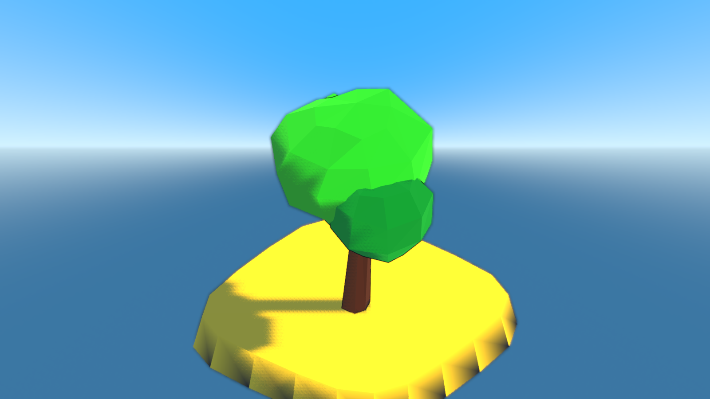
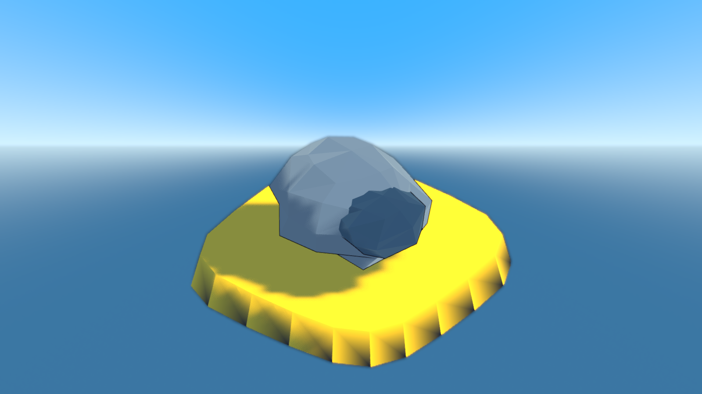
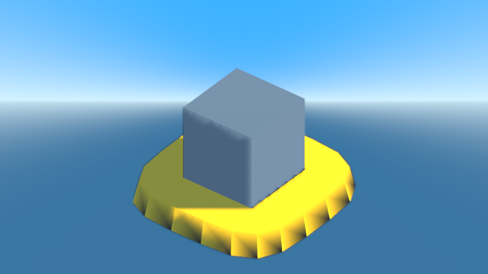
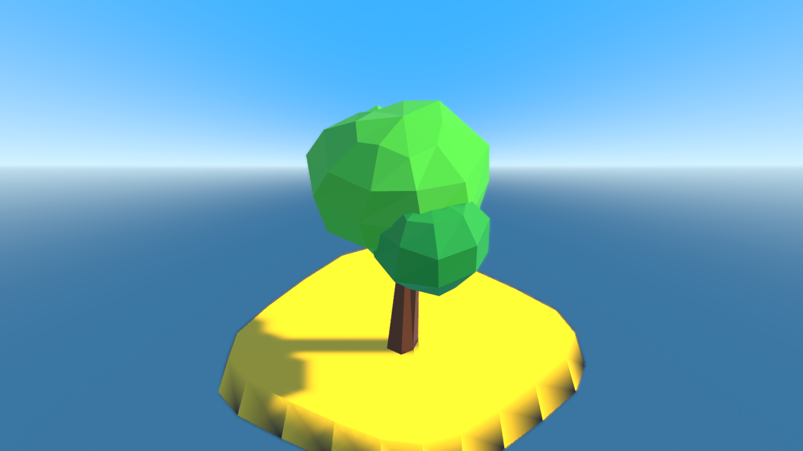
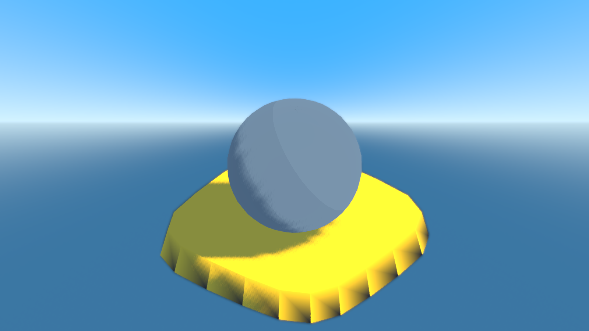

# 美术管线（Pocket Sandbox — NPR Diorama）

> 本文件是 **`AGENTS.md` §一「视觉与渲染标准」的 Godot 落地清单**，由 **S0.5** 产出。
> 权威顺序：`AGENTS.md` §一（规范正文）→ `docs/ROADMAP.md` §3.1（规划）→ 本文件（落地细则）。
> **冲突一律以 `AGENTS.md` 为准**；本文件只回答"在 Godot 里具体怎么做、怎么验"。
>
> 全部截图由真实工具链产出，不是示意图。复现命令见 §5。

---

## 1. §3.1 在 Godot 里的等价映射

`AGENTS.md` §一用的是 Three.js 术语（原规范来源）。本项目是 Godot 4.7，映射如下 ——
**等价映射已建立，不重新选型**（`ROADMAP` §3.1 第 7 条）：

| `AGENTS.md` §一 原文 | Three.js 术语 | 本项目的 Godot 实现 | 代码位置 |
|---|---|---|---|
| 1. 平滑起伏的低多边形网格 | `PlaneGeometry` + 分形噪声 | `SurfaceTool` 程序化生成 + `FastNoiseLite` 分形叠加 | `scripts/world/terrain.gd`、`scripts/core/mesh_util.gd` |
| 1. 清脆利落的面着色 | `toNonIndexed()` | `MeshUtil.facet()`：拆索引 + 逐三角重算法线 + 顶点色 | `mesh_util.gd:18`、`_tri()`/`_tri_grad()` `mesh_util.gd:249/262` |
| 2. 全局卡通着色 | `MeshToonMaterial` + Gradient Map | `Style.toon()` → `shaders/common/toon.gdshader`，3 阶 ramp 由 `Style.build_ramp()` 生成 `GradientTexture1D` | `style.gd:117`、`style.gd:80` |
| 3. 反向外壳描边 | Inverted Hull（`BackSide`） | `shaders/common/outline.gdshader` + `Style.attach_outline()`，宽度按 `pixel_span` 换算成世界单位 | `style.gd:145/157/163` |
| 4. 高饱和纯色调色板 | 硬编码色值 | `Style.PALETTE`（30 个具名色）+ `Style.pal()` / `Style.lit()` | `style.gd:19/104/108` |
| 5. 正交等距视角 | `OrthographicCamera` | `Camera3D.PROJECTION_ORTHOGONAL`，`PITCH = -35.264°`（真正的等距角） | `camera_rig.gd:103` |
| 5. 硬阴影 | `PCFShadowMap` | `DirectionalLight3D` + `SHADOW_ORTHOGONAL`，`light_angular_distance = 0`（硬边） | `day_night.gd:49` |

**术语对照的两个坑**（都踩过）：

- Godot 的"面着色"不是材质开关，而是**网格属性**：必须真的把索引拆开、让每个三角独占三个顶点，
  否则平滑法线会把 3 阶阶梯糊成渐变。`facet()` 干的就是这件事，**没有替代品**。
- 描边不是后处理，是**第二遍绘制**：沿法线膨胀一份背面壳。所以网格的法线必须正确 ——
  `MeshUtil` 的生成器一律按 CCW 写面，`_tri_grad()` 内部再发 `(a, c, b)`，让 Godot
  的顺时针正面约定看到朝外的法线（`mesh_util.gd:257–278`）。

---

## 2. 三个合规样板 / 三个违例反例

六张图来自同一个夹具场景 `scenes/dev/art_samples.tscn`，**同一机位、同一时刻（0.42）、
同一曝光**，只有被展示的那一件不同。所以两张图之间的差异可以归因到"被破坏的那一条规则"上。

### 2.1 合规样板

#### ① `01_ok_tree` —— 合规的植被



| 检查项 | 本例做法 |
|---|---|
| 形状 | 树干 `tapered_cylinder` + 三团 `blob()` 叶冠，**没有一个方块** |
| 面着色 | `blob()` / `tapered_cylinder()` 内部已逐三角写死法线，无需再 `facet()` |
| 噪声 | `roughen(mesh, 0.035, rng, false)` —— 先合并再扰动，它内部会重算法线 |
| 材质 | `Style.toon({shade_min: 0.40, rim: 0.22, rim_color: (1,0.98,0.85), ink: 2.0})` |
| 描边 | 由 `Style.toon()` 默认开启，宽度 2.0 px |
| 颜色 | 全部取自 `Style.PALETTE`（`trunk` / `leaf` / `leaf_dark`），经 `Style.lit()` 转线性 |

#### ② `02_ok_rock` —— 合规的石头



两块 `blob()` 叠成主次，`roughen(..., 0.05, rng, true)` 的 `lock_bottom = true` 把底面锁平，
好让它坐得住。**注意这一条容易被忘**：不锁底面的石头会浮在台面上，或陷进去一半。

#### ③ `03_ok_ball` —— 最省事的合规件


`MeshUtil.blob(1.1, 7, 12, Vector3.ONE, 0.06, rng, Style.lit("stone"))` 一行就是一个合规件：
圆润但有清晰的面，没有平滑渐变。**新物件从这一行开始改，比自己拼 `SurfaceTool` 快得多。**

### 2.2 违例反例

#### ④ `04_bad_box` —— 立方体（守卫规则 `box_mesh` 拦它）



`BoxMesh.new()`。这正是 `AGENTS.md` §一开篇"⚠️绝对禁止使用任何立方体/方块"要禁的东西。
注意材质**仍然是 toon**：图里唯一的问题就是形状本身 —— 一张图只犯一个错，
读者才能看清"是这一条错了"，而不是"整个都错"。

#### ⑤ `05_bad_pbr_tree` —— `StandardMaterial3D`（守卫规则 `standard_material` 拦它）



**与 ① 共用同一个 `ArrayMesh` 实例**，只有材质换了。逐项对比：

| | ① 合规（`Style.toon`） | ⑤ 违例（`StandardMaterial3D`） |
|---|---|---|
| 明暗 | 3 阶硬阶梯，交界清晰 | 连续渐变，没有阶梯 |
| 描边 | 有逆壳黑边 | **没有**（PBR 材质不挂描边） |
| 高光 | 无（`spec_amount = 0`） | 有真实高光（`roughness 0.32`） |
| 观感 | 微缩手办 | 塑料玩具 |

这就是 `AGENTS.md` §一.2 与 §一.3 被同时破坏的样子 —— 而且**只要换一个材质**，
两条规则一起失效。这也是为什么守卫把它列为独立规则。

#### ⑥ `06_bad_smooth_ball` —— 光滑球面（**守卫抓不到**）



`SphereMesh.new()` 直接用：索引网格 + 平滑法线，**没有过 `facet()`**。
与 ③ 并排看，③ 有清晰的面、⑥ 是一片糊。

> ⚠️ **这一条必须记住**：它不是"用了某个被禁的类"，而是**少调了一次函数**。
> 守卫是按 token 扫的，扫不出"这个网格没有面着色"。所以 `box_mesh` / `standard_material`
> 有守卫兜底，**这一类只能靠眼睛和 §4 的检查清单**。别以为"守卫绿了就没问题"。

---

## 3. 如何新建一个合规物件（6 步模板）

以"加一块路标石"为例。**照抄 `03_ok_ball` 那一行，再逐条改**，比从零写快且不会漏项。

### 步骤 1 —— 选形状：只用 `MeshUtil` 的生成器

```gdscript
# ✅ 允许：全部是程序化低模生成器
MeshUtil.blob(radius, rings, segments, squash, jitter, rng, tint)
MeshUtil.cone(radius, height, segments, cap, tint, sway)
MeshUtil.tapered_cylinder(bottom_r, top_r, height, segments, tint, bend, cap_bottom, cap_top)
MeshUtil.superellipse_prism(half_x, half_z, bottom_y, top_y, roundness, corner_steps, tint_top, tint_bottom, taper)

# ❌ 禁止：BoxMesh / CSGBox3D / SphereMesh（未 facet）/ CylinderMesh（未 facet）
```

需要复合形状就用 `MeshUtil.combine([{"mesh": m, "xform": Transform3D(...)}])` 拼，
**不要**去用 CSG 节点。

### 步骤 2 —— 保证面着色

生成器（`blob` / `cone` / `tapered_cylinder` / `superellipse_prism`）**内部已经面着色**，
不需要再调 `facet()`。但只要你引入**任何**外部网格（导入的 `.obj`、引擎内置 primitive），
就必须过一遍：

```gdscript
mesh = MeshUtil.facet(mesh, tint, false)   # 参数：源网格 / 着色 / 是否保留源顶点色
```

`facet()` 之后若还要扰动顶点，用 `MeshUtil.roughen(mesh, amount, rng, lock_bottom)` ——
它内部会 `facet_rebuild()` 重算法线，顺序不能反（先 `roughen` 再 `facet` 会白扰动）。

### 步骤 3 —— 从 `Style.PALETTE` 取色，且转线性

```gdscript
var tint := Style.lit("stone")        # ✅ 具名色 + srgb_to_linear()
var tint := Style.pal("stone")        # ✅ 只取 sRGB（用于 UI / 需要原始值时）
var tint := Color(0.6, 0.65, 0.7)     # ❌ 硬编码色值：调色板外的颜色会破坏统一感
```

新增颜色**先加进 `PALETTE`**，不要在调用点现编。`Style.pal()` 对未登记的 key 返回
品红（`MAGENTA`），这是故意的 —— 让"打错字"在画面上炸出来，而不是静默变成黑色。

### 步骤 4 —— 材质走 `Style.toon()`，并挂描边

```gdscript
var mat := Style.toon({
    "shade_min": 0.40,          # 暗部下限，越低对比越强
    "rim": 0.22,                # 边缘光
    "rim_color": Color(1.0, 0.98, 0.85),
    "ink": 2.0,                 # 描边像素宽度
})                              # outline 默认开启，无需显式传
```

`Style.toon()` 会把材质登记进 `_toon_materials`，`Style.set_outline()` / `set_ink_scale()`
（调试面板的"描边"开关）才能统一改到它。**自己 `ShaderMaterial.new()` 会漏登记**，
表现为"关掉描边后这个物件还有黑边"。

### 步骤 5 —— 挂到场景里，注意投影与可见性

```gdscript
var mi := MeshInstance3D.new()
mi.mesh = mesh
mi.material_override = mat          # ✅ 用 material_override，不要改 surface 材质
mi.cast_shadow = GeometryInstance3D.SHADOW_CASTING_SETTING_ON
add_child(mi)
```

`AGENTS.md` §一.5 要求硬阴影 —— 阴影是风格的一部分，**默认要开**。
量大且远处的植被走 `scatter.gd` 的 `MultiMesh` 路径（它已经处理好实例化与风摆）。

### 步骤 6 —— 跑验收，两件事都要做

```powershell
# ① 静态守卫：新代码不得引入被禁的类
& $GODOT --headless --path $P --script res://tools/verify.gd -- --case=s0_2_guard

# ② 视觉复核：拍一张，用眼睛看（守卫抓不到"没面着色"）
& $GODOTG --path $P -- --shot=my_thing --at="0,1.5,0" --size=5.4 --out=res://.shots/check
```

**②不能省。** 见 §2.2 的 ⑥：`SphereMesh` 不改一行代码就能绕过全部守卫。
静态检查只能保证"没有明显违规"，不能保证"看起来对"。

---

## 4. 提交前自检清单

复制到 PR / 提交信息里逐条打勾：

- [ ] 没有 `BoxMesh` / `CSGBox3D` / `StandardMaterial3D`（守卫会自动查）
- [ ] 没有**未 `facet()`** 的引擎 primitive（`SphereMesh` / `CylinderMesh` / `PlaneMesh` / 导入网格）
- [ ] 所有颜色来自 `Style.PALETTE`，且经 `Style.lit()` 转线性
- [ ] 材质走 `Style.toon()`（自动挂描边 + 登记，可被调试开关统一控制）
- [ ] `cast_shadow` 为 `ON`（除非有明确理由，且理由写进注释）
- [ ] 网格法线朝外（用 `MeshUtil` 的生成器就自动正确；自己写 `SurfaceTool` 必须验）
- [ ] 拍了图并**真的看了**（`--at=` + `--size=` 对准它）

---

## 5. 复现本文的 6 张截图

夹具：`scenes/dev/art_samples.tscn`（脚本 `scripts/dev/art_samples.gd`）。

```powershell
$GODOT  = "G:\godot_project\_godotengine\Godot_v4.7-stable_win64_console.exe"
$GODOTG = "G:\godot_project\_godotengine\Godot_v4.7-stable_win64.exe"
$P      = "G:\godot_project\mc-npr-godot"

# 一次拍完 6 张（6 个展台 x = -45/-27/-9/9/27/45，间距 18）
& $GODOTG --path $P res://scenes/dev/art_samples.tscn -- --shots --case=s0_5_samples `
    --warmup=60 --frames=15 --out=res://.shots/s05
```

**为什么用位置参数传场景**：`godot --path P <scene>` 会直接运行该场景而不经过
`SceneRouter`，因此不触发 `scene_change_owner` 守卫，也不需要给产品码开"演示后门"。
`--scene=` 那个写法属于 S1.0b 的交付范围，**本步尚未实现**（`capture.gd` 不认这个参数）。

**逐张对准某一个展台**：`s0_5_samples` 批次里每张都带 `at` 键，等价于手写

```powershell
& $GODOTG --path $P -- --shot=01_ok_tree --at="-45,1.75,0" --size=5.4 --yaw=38 --out=res://.shots/x
```

`--at=` 只移动相机焦点（`CameraRig.snap_to()`），不改任何世界状态 —— 它是**纯修饰符**，
单独给 `--at=` 不会唤醒截图批次。

**基线 sha256**（`--out=res://.shots/s05`，两次独立进程实测 6/6 相同）：

| 图 | sha256 |
|---|---|
| `01_ok_tree.png` | `8e9eb7729310a58515000837083d49d40d436aec8ea35b22ce922f20b0e77396` |
| `02_ok_rock.png` | `3090be3f7f9732386e0df8c39984720b9f41c1192bb1cc3f70457428dbe48911` |
| `03_ok_ball.png` | `47e5726ff7e89c9e52c161b8d048c433f807cd83a3b5352e1b40f98410dc83b6` |
| `04_bad_box.png` | `028f59de9a71c119dbd056c199a372847006aa0bf94541a523c150bd2bfb0dfd` |
| `05_bad_pbr_tree.png` | `d72320a406c173a2ec9d2d475c9990ec3985190be9b1d74e0be5837341a11f6b` |
| `06_bad_smooth_ball.png` | `e8bacde3c25971b18663548af75b3aa369b1cd7557db9debad1fd90e39b1ec0d` |

---

## 6. 夹具为什么允许故意违例

`scripts/dev/art_samples.gd` 里真的有 `BoxMesh` 与 `StandardMaterial3D`。它们已在
`tools/verify.gd` 的 `GUARD_WHITELIST` 里逐条登记并写明理由，**守卫报告每次运行都会把
这两行显式打印出来**，不静默放过。

配套的硬约束（由 `s0_5_doc_conventions` 用例断言）：

1. **产品码一律不得引用 `scripts/dev/`** —— 教材目录只能是叶子，不能被 `scenes/` 或
   `scripts/` 的其它文件 `preload` / `load`。
2. **夹具的命中数必须恰好等于登记数** —— 否则"白名单里有两条"就成了凭空多出来的豁免，
   而不是可解释的反例。

> 曾经考虑把夹具放进 `tools/`（该目录不在守卫扫描范围内，能"免费"绕过检查）。
> **否决了**：那样反例就是靠"藏在扫描盲区"通过，而不是靠"被登记且被解释"通过。
> 两者在出问题时给人的信号完全不同 —— 后者会在每次验收日志里主动提醒你它的存在。

---

## 7. 与其它文档的关系

| 文档 | 关系 |
|---|---|
| `AGENTS.md` §一 | **规范正文**，本文件的上位；冲突以它为准 |
| `docs/ROADMAP.md` §3.1 | 规划的等价映射与守卫要求；本文件是它的展开 |
| `docs/ENGINEERING.md` §11–§12 | 允许/禁止清单、新增物件 checklist 的工程侧对应 |
| `docs/ENGINEERING.md` §4 | `B-` 6 机位基线（主场景，与本文件的 6 张教材图是**两组**基线） |
